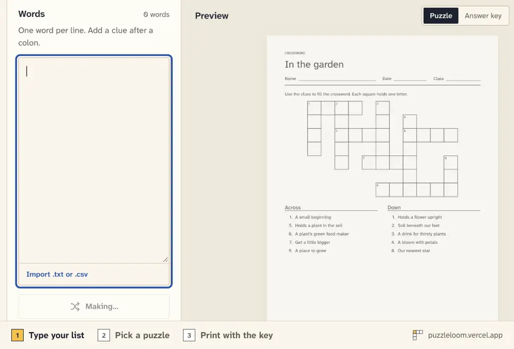
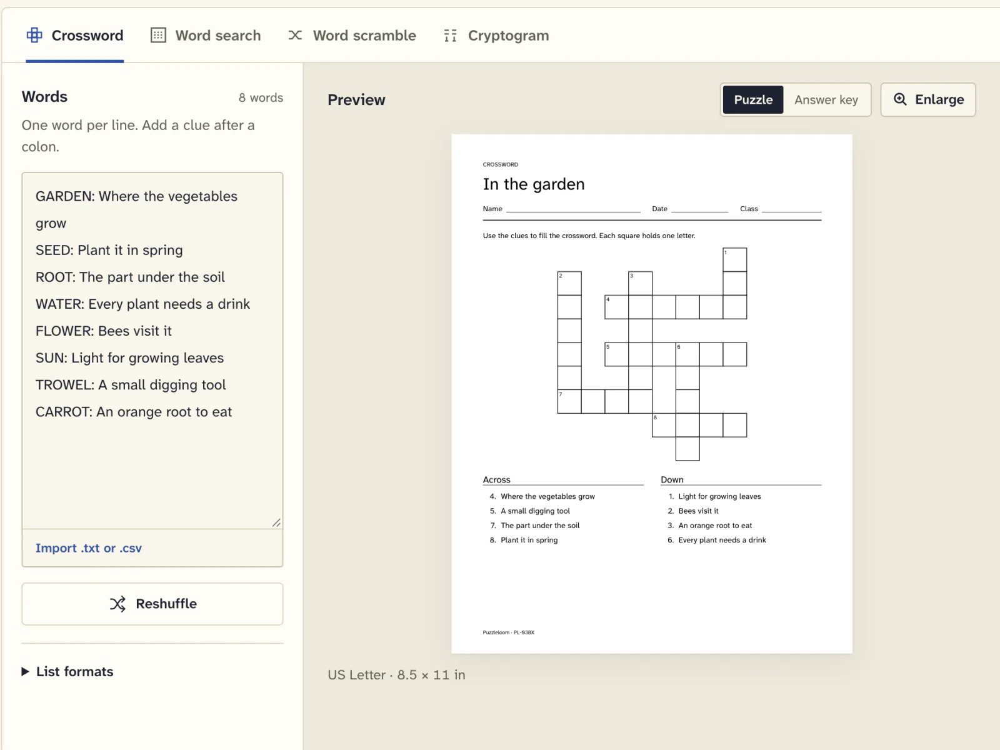
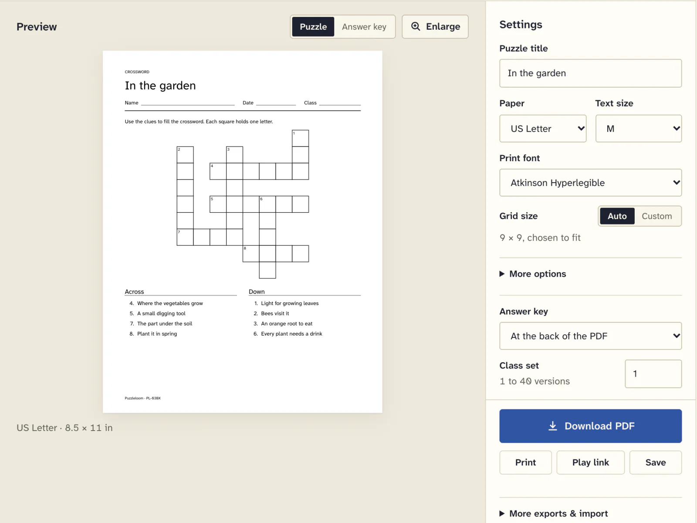
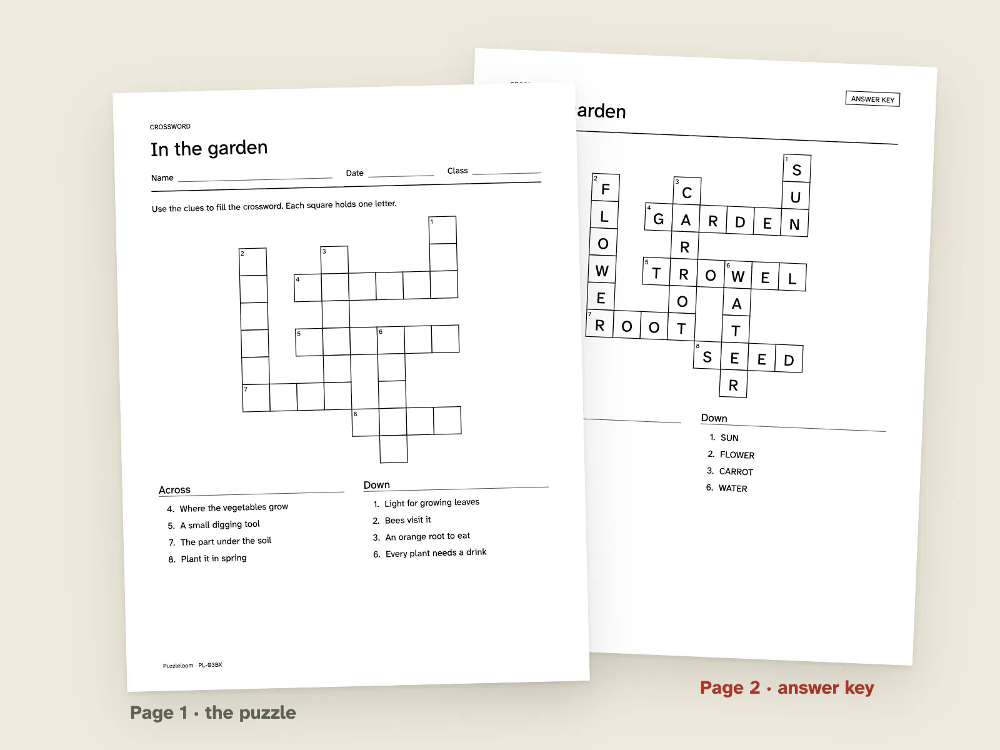
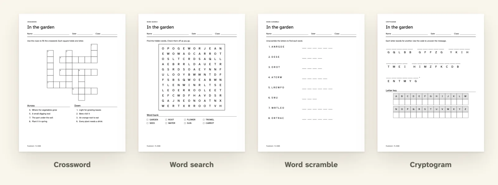

<p align="center">
  <picture>
    <source media="(prefers-color-scheme: dark)" srcset="docs/media/hero-dark.webp">
    
  </picture>
</p>

<p align="center">
  <a href="https://puzzleloom.vercel.app">
    <picture>
      <source media="(prefers-color-scheme: dark)" srcset="apps/web/public/brand/wordmark-night.svg">
      
    </picture>
  </a>
</p>

<h3 align="center">Type a word list. Print a puzzle with its answer key.</h3>

<p align="center">
  Puzzleloom makes crosswords, word searches, word scrambles and cryptograms from your own words.<br>
  It has no ads, no account and no watermark, and your words never leave your browser.
</p>

<p align="center">
  <a href="https://puzzleloom.vercel.app"></a>
</p>

<p align="center">
  <a href="LICENSE"></a>
  
  
  
  
  <a href="AGENTS.md"></a>
</p>

<p align="center">
  <a href="#from-a-list-to-a-printed-page">Demo</a> ·
  <a href="#features">Features</a> ·
  <a href="#privacy">Privacy</a> ·
  <a href="#how-the-layout-guarantee-works">How it works</a> ·
  <a href="#for-agents-cli-and-mcp">CLI and MCP</a> ·
  <a href="#run-it-locally">Run it</a>
</p>

---

## From a list to a printed page

Type the words once. Puzzleloom shows the actual page, the same layout that goes into the PDF, so you can check it before you print. Put the answer key at the back of the file, in a second file, or leave it out.

<table>
  <tr>
    <td width="33%">
      <picture>
        <source media="(prefers-color-scheme: dark)" srcset="docs/screenshots/list-dark.webp">
        
      </picture>
      <br><sub><b>1. Type your list.</b> One word per line, with an optional clue after a colon.</sub>
    </td>
    <td width="33%">
      <picture>
        <source media="(prefers-color-scheme: dark)" srcset="docs/screenshots/preview-dark.webp">
        
      </picture>
      <br><sub><b>2. Pick a puzzle and check the page.</b> The preview is the page that prints.</sub>
    </td>
    <td width="33%">
      <picture>
        <source media="(prefers-color-scheme: dark)" srcset="docs/screenshots/print-dark.webp">
        
      </picture>
      <br><sub><b>3. Print it with the key.</b> Vector PDF, Letter or A4, answer key included.</sub>
    </td>
  </tr>
</table>

## Why Puzzleloom

- **Every word is placed, or you're told why.** The crossword engine tries many layouts and keeps the most compact connected grid. If a word can't join it, you see which word and why. Nothing is dropped silently.
- **One list, four puzzles.** The crossword, word search, scramble and cryptogram tabs read the same list, so switching type never means retyping.
- **A class set in one file.** Up to 40 different layouts of the same words, each with its own printed ID and its own key.
- **No ads, no account, no upload.** It's a static site. Your words stay in your browser.
- **Agents can run it too.** The same engine runs as a CLI with clean JSON and as a local MCP server. Your assistant writes the clues; Puzzleloom lays out the grid and checks the key.
- **Free.** MIT licensed, with no locked features and no watermark.

<picture>
  <source media="(prefers-color-scheme: dark)" srcset="docs/screenshots/types-dark.webp">
  
</picture>

## Features

### Make a puzzle

- Type one word per line. Add a clue after a colon, a tab or a spaced dash (`GARDEN: A place to grow`). Import `.txt`, CSV or TSV. Up to 40 words.
- Your list is cleaned up as you type: characters removed from a word (`H2O` becomes `HO`), lines without letters and duplicates are listed under "Changes to your list" instead of disappearing.
- **Crossword:** one connected grid with standard across and down numbering and no stray adjacent letters.
- **Word search:** each word appears exactly once. Easy runs across and down, medium adds diagonals, hard uses all eight directions. The fill never spells a word from a built-in blocklist.
- **Word scramble:** the same letters in a different order, never equal to the word. Hints can be none, the first letter or the clue.
- **Cryptogram:** a letter-substitution cipher of a quote or sentence you type, or one of the sample quotes. No letter maps to itself, and spaces and punctuation stay. Optionally show some given letters.
- Reshuffle for a new layout. Every puzzle has a seed and a short printed ID, and the same words, options and seed always give the same layout.
- Edit the title, the instructions and the Name, Date and Class fields.

### Language and fonts

- Seven alphabets: English, Spanish, French, German, Portuguese, Italian and Dutch. Accented letters are kept, with options to strip accents or expand ß to SS.
- Print in Atkinson Hyperlegible or the OpenDyslexic font. OpenDyslexic is offered as a choice; Puzzleloom makes no claim that it improves reading.
- Text size S, M, L or XL for large-print sheets. Long clues and quotes paginate rather than being clipped.
- Light and dark themes, and a layout that works on a phone.

### Print and export

- Vector PDF in black on white, with the fonts embedded, in US Letter or A4. The preview and the PDF come from the same page layout.
- Answer key at the back of the PDF, as a separate file, or left out.
- **Class sets:** 1 to 40 versions in one PDF. Each has a different arrangement of the same words, its own printed ID and its own key at the back.
- Export a page as SVG or PNG. The CLI can also combine several puzzles into one book PDF.

### Save and share

- **Save** keeps a puzzle in this browser's IndexedDB under "My puzzles". Open, duplicate and delete them there.
- Export a `.puzzleloom.json` project file to back a puzzle up or move it to another device. The format is [`puzzleloom.puzzle/v1`](apps/web/public/puzzleloom.schema.json), with a published JSON Schema.
- **Play links** put the whole puzzle in the part of the URL after `#`, so nothing is uploaded. The player works in a phone or laptop browser: type into the crossword, drag across words in the search, check your answers and open the puzzle in the maker. A play link contains the answers, so it suits practice, not a graded test. You can switch off Reveal in the link.

### For agents

- `puzzleloom` CLI: `make`, `render`, `check`, `link`, `book` and `mcp`. With `--json`, stdout is exactly one JSON document and exit codes are stable.
- A local stdio MCP server with seven tools: `create_puzzle`, `validate_puzzle`, `render_pdf`, `render_image`, `make_play_link`, `make_book` and `list_options`.
- Same input, same output: the same words, options and seed give the same layout and the same PDF bytes. The details are in [AGENTS.md](AGENTS.md).

## Privacy

Puzzleloom is a set of static files with no server behind them. Once the page has loaded it makes no network requests: no analytics, no ads, no fonts from a font service and no third-party scripts. Puzzles, PDFs and saved projects are made in your browser. Saved puzzles live in your browser's IndexedDB on your device only, so clearing site data removes them. Download a project file if you want a backup.

A play link carries the puzzle and its answers in the URL fragment, which browsers don't send when they load a page. Anyone who has the link can read it.

The CLI and MCP server run on your machine and make no network calls either. There are no API keys, no accounts and no built-in language model.

## How the layout guarantee works

A crossword is the hard one, and the claim is narrower than "always works".

1. **Many tries, bounded.** The engine tries many arrangements from the seed and keeps the most compact connected grid. The search has a limit, so it always finishes.
2. **Never drops a word.** A successful result places every word in one connected grid. There is no "placed 18 of 20" outcome.
3. **Explains a failure.** If the search can't place a word, it fails and names the words that didn't fit, for example `ZZZ shares no letters with the other words. Add a connecting word.` A list like OCEAN, LEAF and PEAR has no valid crossing at all, because every shared letter sits next to another.
4. **Auto grid size.** Leave the size on Auto and the engine starts from an estimate and widens the allowed box only until a layout fits, then keeps the tightest one. Pick a size from 8 to 30 and it becomes a hard limit: the box never grows, and a list that doesn't fit fails with an explanation. The size used is recorded in the project.
5. **Checked independently.** A separate validator re-checks every puzzle: connectivity, no accidental adjacent letters, each word-search entry present exactly once, no blocked word in the fill.

Running out of arrangements isn't a proof that no layout exists, so if a list fails, try adding a linking word. Some numbers from `pnpm bench`, on one laptop: with automatic sizing, 60 seeds each of 10, 15, 25 and 40 short garden words all completed and validated, at a median of 3 to 51 ms and a mean grid size of 10 to 21. Forty words of 7 to 14 letters came out at a mean size of about 24. Timings depend on the machine; the full tables, including explicit sizes, are in [docs/build/bench.md](docs/build/bench.md).

Word-search blocklist hits across all benchmark grids: zero. The blocklist is small (English, plus brief Spanish, French and German profanity and slurs), so it isn't a complete content filter. A word you type yourself is exempt.

## For agents: CLI and MCP

The CLI isn't on npm, so run it from a clone. You need Node 22.13 or newer and pnpm 11.

```bash
pnpm install
printf 'GARDEN: A place to grow\nTROWEL: A small hand tool\nSEED: Plant it\nCARROT\nPOTATO\n' > words.txt
node packages/cli/bin.mjs make crossword --words words.txt --seed 42 \
  --out lesson.puzzleloom.json --pdf lesson.pdf --json
```

Call it with `node`, not `pnpm`: when a command fails, `pnpm <script>` appends its own `[ELIFECYCLE]` line to stdout, which breaks `--json`. With `--json` the output is `{"ok":true,"result":...}` on success and `{"ok":false,"error":"..."}` on failure. A failed `check` adds `errors`, and a failed `make` adds `words` when specific words are to blame. Exit code `0` is success, `1` is an input or runtime failure and `2` is an unknown command.

```bash
node packages/cli/bin.mjs check lesson.puzzleloom.json --json            # re-validates every guarantee
node packages/cli/bin.mjs render lesson.puzzleloom.json --variants 30 --key appended --pdf class.pdf
node packages/cli/bin.mjs render lesson.puzzleloom.json --png --out lesson.png
node packages/cli/bin.mjs link lesson.puzzleloom.json --json              # a play link; it contains the answers
node packages/cli/bin.mjs make cryptogram --quote "Practice makes progress." --seed 7 --pdf quote.pdf
```

`make` returns `{puzzle, warnings, path?, pdf?}`. `warnings` lists anything it changed or skipped in your list, such as `H2O` becoming `HO`. Leave `--size` off for automatic sizing, or give `--size 8..30` to force it. Other options are `--paper letter|a4`, `--difficulty easy|medium|hard`, `--font atkinson|opendyslexic`, `--font-size S|M|L|XL`, `--language en|es|fr|de|pt|it|nl` and `--key appended|separate|none`. Run `node packages/cli/bin.mjs --help` for the rest.

To use the MCP server, point your client at it. This config works from a clone with no working directory setting:

```json
{
  "mcpServers": {
    "puzzleloom": {
      "command": "node",
      "args": ["/abs/path/to/puzzleloom/packages/cli/bin.mjs", "mcp"]
    }
  }
}
```

If your client can set a working directory, `pnpm mcp` from the checkout is the same server. The tools read and write files on your machine, and nothing is sent anywhere. The full reference, with the tool list, the project format and worked examples, is in [AGENTS.md](AGENTS.md), and a compact version for agents is served at [/llms.txt](https://puzzleloom.vercel.app/llms.txt).

## Run it locally

You need Node 22.13 or newer and pnpm 11.

```bash
corepack enable
pnpm install
pnpm dev
```

Then open http://localhost:4317. `pnpm install` prepares the font bundles and the JSON Schema.

Puzzleloom builds to plain static files. There are no environment variables, API routes or databases, so any static host works.

```bash
pnpm build      # writes apps/web/out/
pnpm preview    # optional: serve it at http://localhost:4317
```

## Limits

- The bundled print fonts cover the Latin-script alphabets listed above. A character they can't draw causes an explicit export error rather than a blank box. Other scripts aren't supported.
- Large grids in XL text may need fewer words or a smaller grid to fit the page.
- Class sets can run out of distinct layouts for very small lists. The export says so instead of repeating one.
- After the page has loaded, making, saving and exporting work offline. There is no service worker, so a first visit needs a connection.
- Chromium is tested automatically. Physical printers, Safari and Firefox on real devices haven't had a manual check yet.

## Development

The project was built in the open, step by step, and the working notes are in [docs/build/](docs/build/): the original [brief](docs/build/BRIEF.md), the [plan](docs/build/PLAN.md), the [acceptance checklist](docs/build/ACCEPTANCE.md) and the [benchmark](docs/build/bench.md).

```bash
pnpm test       # unit, property, golden, PDF, CLI and MCP tests
pnpm e2e        # Chromium end-to-end, accessibility and privacy checks, including no network after load
pnpm verify     # typecheck, lint, tests, licence check, static build, e2e and a dev-server smoke test
pnpm bench      # crossword and word-search benchmark, writes docs/build/bench.md
```

Stop your own dev server before `pnpm verify`; its final smoke check starts one on port 4318. Browser tests use `CHROMIUM_PATH` when set, otherwise a system Chromium. On other machines run `pnpm exec playwright install --with-deps chromium`.

| Path | What it is |
| --- | --- |
| [`packages/core`](packages/core) | Text normalisation, seeded random numbers, the four generators, the independent validator, the project schema and play links. |
| [`packages/render`](packages/render) | One positioned page layout for SVG previews, PNGs and PDFs, with embedded fonts and pagination. |
| [`packages/cli`](packages/cli), [`packages/mcp`](packages/mcp) | The command line and the local MCP server over the same engines. |
| [`apps/web`](apps/web) | The static Next.js site. Generation and PDF work run in a Web Worker. |

## Credits

Puzzleloom uses [pdf-lib](https://github.com/Hopding/pdf-lib) and [fontkit](https://github.com/foliojs/fontkit) for the PDF, [fflate](https://github.com/101arrowz/fflate), [idb](https://github.com/jakearchibald/idb), [Zod](https://zod.dev), the [MCP TypeScript SDK](https://github.com/modelcontextprotocol/typescript-sdk), [Next.js](https://nextjs.org), [React](https://react.dev) and [Tailwind CSS](https://tailwindcss.com). Headings are set in [Young Serif](https://fontsource.org/fonts/young-serif) and the interface and print text in [Atkinson Hyperlegible Next](https://github.com/googlefonts/atkinson-hyperlegible-next), with [OpenDyslexic](https://github.com/antijingoist/opendyslexic) as an optional print font. All three fonts are under the SIL Open Font License 1.1. The example word lists and quotes are original and released under CC0. The logo, icons and social image are drawn in code. Full notices, including a few approved transitive licences, are in [CREDITS.md](CREDITS.md).

## License

[MIT](LICENSE) © 2026 Bilal Tahir. Fonts are under the SIL Open Font License 1.1 and the example word lists under CC0.

## Support

Puzzleloom is free and ad-free. If it saved you an evening of making worksheets, you can [support the project](https://puzzleloom.vercel.app/support/) with a one-off tip or a small monthly contribution.
